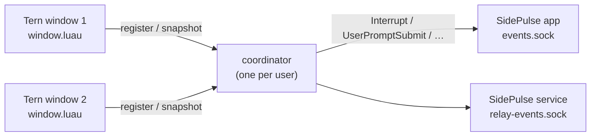

# tern-sidepulse

A [Tern](https://stencil.so/tern) window plugin that shows the [OMP](https://github.com/can1357/oh-my-pi) sessions in your open Tern windows on [SidePulse](https://github.com/inteliwear/sidepulse): working, waiting for you, just finished, or failed. Sessions on an attached remote host count too, as long as a window shows them.

Tern supplies the observations. SidePulse owns the LEDs and combines this plugin's contribution with every other agent it monitors. The plugin never submits prompts, approves anything, reads transcripts, or changes layouts.

## What you see

| OMP in a visible Tern window | SidePulse |
| --- | --- |
| Any session working | `working` (your configured working animation) |
| Any session waiting for input (an `ask`, an approval) | `waiting_for_input`; outranks working |
| A turn finished | `completed` for 15 s, unless the session resumes first |
| A turn failed | `blocked_error` for 30 s, unless the session resumes first |
| Nothing visible, or all idle | the plugin's contribution is withdrawn (`idle_ready`) |

Closing a pane, losing a host connection, disabling the plugin, or closing the last window withdraws the contribution within about 20 s. Several windows produce one coherent contribution: duplicates are reduced, never counted.

## Requirements

- macOS with Tern 0.9.12 or later (the versions actually exercised are in [docs/compatibility.md](docs/compatibility.md)).
- SidePulse's agent monitor installed on the same Mac: the menu-bar app, the headless service, or both.
- Python 3.10 or later at a known absolute path. Homebrew's `/opt/homebrew/bin/python3` is found automatically; `/usr/bin/python3` is used only when the Command Line Tools provide it. Nothing is installed with `pip`.
- Remote hosts need nothing: no SidePulse, no helper, no service.

## Install

Development link (loads from the checkout; saving a file reloads the plugin):

```sh
tern plugin link /absolute/path/to/tern-sidepulse
tern plugin reload tern-sidepulse
```

Installed copy from the default branch:

```sh
tern plugin install github.com/alphastorm/tern-sidepulse
```

To pin a release, check out its tag and `tern plugin install /path/to/checkout`. There is no update command: install again with `--force`, or `git pull` a linked checkout.

Existing OMP sessions are discovered within about five seconds of loading; nothing needs restarting.

## Commands

From the Tern palette:

| Command | Does |
| --- | --- |
| SidePulse bridge: doctor | Checks Python, the data and runtime directories, the coordinator, this window's observer, and each SidePulse receiver; toasts a one-line summary and writes `~/.local/state/tern-sidepulse/doctor.json` |
| SidePulse bridge: resync | Registers this window afresh and resends the current state to SidePulse |
| SidePulse bridge: disable | Persists a disabled latch, revokes every window, and sends neutral |
| SidePulse bridge: enable | Clears the latch; windows register again on their next cycle |

The same operations from a shell, for scripts or when a window is not available:

```sh
python3 bridge.py status   --data-dir "$HOME/Library/Application Support/Tern/plugin-data/tern-sidepulse"
python3 bridge.py doctor   --data-dir "$HOME/Library/Application Support/Tern/plugin-data/tern-sidepulse"
python3 bridge.py disable  --data-dir "$HOME/Library/Application Support/Tern/plugin-data/tern-sidepulse"
python3 bridge.py enable   --data-dir "$HOME/Library/Application Support/Tern/plugin-data/tern-sidepulse"
```

Every command prints one JSON object. A successful socket write to SidePulse is delivery, not an LED check.

## Configuration

Optional `config.json` in the plugin data directory (a regular file of at most 64 KiB, not a symlink; both halves ignore anything else):

```json
{
  "python": "/opt/homebrew/bin/python3.13",
  "ui_sockets": ["/custom/path/events.sock"],
  "service_sockets": ["/custom/path/relay-events.sock"]
}
```

`python` overrides interpreter discovery. The socket lists override SidePulse's default candidates (`$XDG_STATE_HOME/sidepulse/agent-monitor`, then `~/.local/state/sidepulse/agent-monitor`, with SidePulse's `/tmp` fallback for a long `relay-events.sock` path). Timing constants are fixed; tests inject them.

## How it works



- Each window enumerates `cx.agents:list()` every 5 s and on `agent_state` / `agent_finished` / `pane_closed` events, keeps OMP sessions on connected hosts, and sends a complete snapshot (pane id, state, outcome notice) through `bridge.py` to a local Unix socket. Pane ids never leave the window's namespace.
- The coordinator is started on demand by the first helper call, holds a singleton lock, serializes everything, reduces all windows' snapshots to one SidePulse mode (`blocked_error > waiting_for_input > working > completed > idle_ready`), and sends it to both receiver families with bounded retry. Windows hold a 15 s lease renewed by each complete snapshot; a vanished window stops contributing when its lease ends. After the last lease, the coordinator sends neutral and exits.
- The plugin data directory holds configuration, the stable bridge identity (`identity.json`, which gives the one synthetic SidePulse session `tern-sidepulse:<uuid>`), the disabled latch, and a bytecode cache (`pycache/`, so a helper never writes inside the plugin directory Tern watches). Observations live in memory, so a restart cannot resurrect an old approval.

Full protocol, fencing, and lease semantics are documented in the source (`tern_sidepulse/coordinator.py`); the verified SidePulse wire contract is in `tern_sidepulse/transport.py` and [docs/compatibility.md](docs/compatibility.md).

## Privacy and hardening

The plugin reads `pane`, `state`, `kind`, `program`, `host`, and `alive` from each agent row and the surface role of each pane. It never reads titles, working directories, models, prompts, assistant text, tool arguments, or transcript paths, and none of those exist in the helper protocol, the coordinator log, the doctor report, or the SidePulse payload (`tests/test_privacy.py` pins this). SidePulse receives status metadata only, on local sockets.

Nothing listens on the network. The coordinator socket, lock, log, and doctor report live in a user-private directory (mode 0700, ownership checked, symlinks refused); they, `identity.json`, and the latch are created with mode 0600. Requests are strict JSON (no `NaN`/`Infinity`, no recursion on deep nesting), capped at 256 KiB, framed by EOF with a 2 s read deadline, and limited to 32 concurrent connections; a malformed or hostile same-user client gets a structured rejection and never unwinds the coordinator. Helpers run with `python3 -I -S` (no environment, no site-packages), as argument vectors, never through a shell; the only configurable executable is the absolute `python` path in your own `config.json`. A plain `python3 bridge.py …` from a shell writes no bytecode into the plugin directory either.

## Diagnostics

- `~/.local/state/tern-sidepulse/coordinator.log` (rotated at 1 MiB) records mode changes, deliveries, lease expiries, and failures, never payloads. When `$HOME` is so deep that the socket path would exceed macOS's limit, the runtime directory moves to `$TMPDIR/tern-sidepulse` (the user's private temp directory); doctor prints the directory in use.
- `~/.local/state/tern-sidepulse/doctor.json` is the last doctor report.
- SidePulse's own view of the result is read-only in `~/.local/state/sidepulse/agent-monitor/latest.json` and `status-history.jsonl`.
- Tern's log shows one warning when helper calls start failing and one when they recover (both at warn level, so Tern's default log filter shows them; `tern::plugin` target).

Developing from a linked checkout: Tern reloads the plugin on every change inside the directory, including git's own files. If `core.fsmonitor` is on globally, set `git config --local core.fsmonitor false` in the checkout, or the plugin reloads on every git command.

## Uninstall

1. Run **SidePulse bridge: disable** (or `bridge.py disable`). This persists the latch, revokes every window, and sends neutral, so late helpers cannot restore an old state.
2. `tern plugin unlink tern-sidepulse` for a development link, `tern plugin remove tern-sidepulse` for an installed copy.
3. The coordinator drains on its own: about 5 s after neutral is delivered, at most 60 s if SidePulse is unreachable (`pgrep -f "bridge.py coordinator"` shows it).
4. Tern keeps the plugin data directory (`identity.json`, the latch, `pycache/`). A reinstall therefore starts disabled; run **SidePulse bridge: enable**. Delete `~/.local/state/tern-sidepulse` and the data directory only after step 3, if you want a clean slate.

## Known limitations

- Tern samples agent state, so a turn that fails within a second may not produce a `working` sample; the outcome notice still shows.
- One synthetic SidePulse session represents all windows; distinct OMP agents are not counted.
- Cleanup after the last window closes depends on the coordinator staying alive and SidePulse being reachable within the final 60 s grace. A hard-killed coordinator or a longer outage leaves the last mode until the next coordinator start clears the same identity.
- Remote coverage follows the window's connection state; nothing is polled on a remote host after all windows close.
- A pane counts while Tern shows an `omp.session` surface in it (so `env … omp` and similar wrappers work); the role is re-read on every reconciliation, so OMP still starting is not counted until then, and a pane that stops being an OMP session drops out within 5 s.
- A window renews its 15 s lease every 5 s, so it survives one failed helper call; two consecutive failures expire it and its contribution is withdrawn for the ~150 ms it takes to register again.
- The coordinator answers each client on a blocking write with a 0.5 s deadline; a same-user client that connects and never reads can delay the loop by that much per connection, 32 connections at most. Leases and notices are checked against the clock afterwards, so a stalled loop withdraws rather than prolongs a state.

## Development

```sh
python3 -B -m unittest discover -s tests -t . -v   # -B: the test runner must not write bytecode into a linked checkout, which reloads the plugin
luau-lsp analyze --definitions=types/tern.d.luau window.luau
```

`types/tern.d.luau` is the `tern plugin types` output of the Tern release the plugin was exercised with; regenerate it when targeting a newer Tern. Set `SIDEPULSE_PYTHON` to a SidePulse interpreter to run the contract test against the real normalizer; `TERN_SIDEPULSE_SLOW_TESTS=1` enables the default-limits timing test.

## License

MIT, see [LICENSE](LICENSE).
