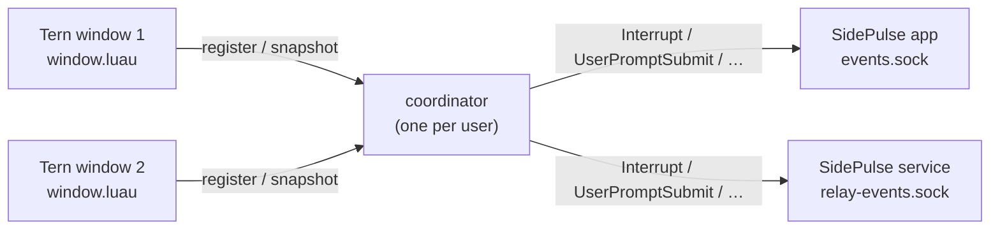

# tern-sidepulse

SidePulse for OMP (`tern-sidepulse`) is a [Tern](https://stencil.so/tern) window plugin that shows the [OMP](https://github.com/can1357/oh-my-pi) sessions visible in your open Tern windows on [SidePulse](https://github.com/inteliwear/sidepulse), including sessions on attached remote hosts. Tern supplies the window state and SidePulse drives the LEDs and menu-bar status alongside your other monitored agents; the plugin never reads transcripts, submits prompts, approves actions, or changes window layouts.

## What you see

| OMP in a visible Tern window | SidePulse |
| --- | --- |
| Any session working | `working` (your configured working animation) |
| Any session waiting for input (an `ask`, an approval) | `waiting_for_input`; outranks `working` |
| A turn finished | `completed` for 15 s, unless the session resumes first |
| A turn failed | `blocked_error` for 30 s, unless the session resumes first |
| Nothing visible, or all idle | `idle_ready` (clears this plugin's status) |

Closing a pane, losing a host connection, disabling the plugin, or closing the last window clears the status within about 20 s. Multiple Tern windows combine into one session on SidePulse: duplicates across windows are reduced, never counted.

## Requirements

- macOS with Tern 0.9.12 or later (exercised versions are in [docs/compatibility.md](docs/compatibility.md)).
- SidePulse's agent monitor on the same Mac: the menu-bar app, the headless service, or both.
- Python 3.10 or later at a known absolute path: Homebrew's `/opt/homebrew/bin/python3` or `/usr/local/bin/python3`, a versioned `python3.10`–`python3.14` in either prefix, the python.org framework's `python3`, or `/usr/bin/python3` only when the Command Line Tools provide it. Nothing is installed with `pip`.
- Remote hosts need nothing installed: no SidePulse, no helper, and no service.

## Install

Link a checkout for development (saving any file in the checkout reloads the plugin):

```sh
tern plugin link /absolute/path/to/tern-sidepulse
tern plugin reload tern-sidepulse
```

Or install a copy from the default branch:

```sh
tern plugin install github.com/alphastorm/tern-sidepulse
```

To pin a release, check out its tag and run `tern plugin install /path/to/checkout`. To update an installed copy, run `tern plugin install --force github.com/alphastorm/tern-sidepulse`; for a linked checkout, run `git pull`.

## Confirm it works

1. Wait about 5 s after installing or linking so the window registers and picks up any existing OMP sessions (nothing needs restarting).
2. Open the Tern command palette and run `tern-sidepulse: doctor`. Expect a toast starting with `ok:` (`ok: 0 issue(s); socket delivery is not an LED check`). A toast starting with `warn:` names a check that needs attention, such as one SidePulse receiver not running or no snapshot yet; `~/.local/state/tern-sidepulse/doctor.json` lists each check and its remedy.
3. Check SidePulse's menu-bar app (or `~/.local/state/sidepulse/agent-monitor/latest.json` when running headless): while an OMP session works or waits, one session from origin `Tern` (`OMP in Tern`) appears.

## Commands

From the Tern command palette:

| Command | Does |
| --- | --- |
| `tern-sidepulse: doctor` | Checks Python, the data and runtime directories, the coordinator, this window, and each SidePulse receiver; shows a one-line toast and writes `~/.local/state/tern-sidepulse/doctor.json` |
| `tern-sidepulse: resync` | Re-registers this window and resends the current state to SidePulse |
| `tern-sidepulse: disable` | Persists the `disabled` latch file, drops every registered window, and clears this plugin's status on SidePulse |
| `tern-sidepulse: enable` | Removes the `disabled` latch file; this window registers right away and other open windows on their next 5 s cycle |

The same operations, plus `status`, from a shell in the plugin directory with Python 3.10 or later:

```sh
python3 bridge.py status   --data-dir "$HOME/Library/Application Support/Tern/plugin-data/tern-sidepulse"
python3 bridge.py doctor   --data-dir "$HOME/Library/Application Support/Tern/plugin-data/tern-sidepulse"
python3 bridge.py disable  --data-dir "$HOME/Library/Application Support/Tern/plugin-data/tern-sidepulse"
python3 bridge.py enable   --data-dir "$HOME/Library/Application Support/Tern/plugin-data/tern-sidepulse"
```

Every CLI command prints one JSON object to stdout. A successful socket write to SidePulse confirms local delivery, not physical LED output.

## Configuration

To override Python discovery or SidePulse socket paths, create `config.json` in `$HOME/Library/Application Support/Tern/plugin-data/tern-sidepulse` (must be a regular file of at most 64 KiB, not a symlink; anything else is ignored):

```json
{
  "python": "/opt/homebrew/bin/python3.13",
  "ui_sockets": ["/custom/path/events.sock"],
  "service_sockets": ["/custom/path/relay-events.sock"]
}
```

`python` sets the absolute path to a Python 3.10+ interpreter; reload the plugin (`tern plugin reload tern-sidepulse`) after changing it. `ui_sockets` and `service_sockets` override SidePulse's default socket candidates in `$XDG_STATE_HOME/sidepulse/agent-monitor` and `~/.local/state/sidepulse/agent-monitor` (including SidePulse's `/tmp/sidepulse-relay-<uid>-<hash>.sock` fallback when the `relay-events.sock` path exceeds 96 bytes) the next time the coordinator starts.

## How it works



- Each Tern window runs an *observer* (the per-window `window.luau` instance) that checks `cx.agents:list()` every 5 s and on `agent_state`, `agent_finished`, `pane_closed`, `session_ended`, and `budget` events (coalesced over 75 ms). It keeps OMP panes on connected hosts whose live surface role is `omp.session` and sends a complete snapshot (pane id, state, and any 15 s completion or 30 s failure notice) through `bridge.py` to the local coordinator socket.
- The first helper call spawns one background coordinator per user that holds a singleton lock, combines all windows' snapshots in priority order (failed, waiting, working, finished, idle), and delivers the result to both SidePulse receivers (the menu-bar app on `events.sock` and the headless service on `relay-events.sock`) with bounded retry. Each window holds a 15 s *lease* (an expiry timer renewed by every complete snapshot); a closed window stops contributing when its lease expires, and the coordinator sends a final clear event and exits 5 s after the last lease ends (or after at most 60 s if SidePulse is unreachable).
- The plugin data directory (`$HOME/Library/Application Support/Tern/plugin-data/tern-sidepulse`) holds `identity.json` (which sets the synthetic SidePulse session id `tern-sidepulse:<install_id>`), optional `config.json`, the `disabled` latch file, and `pycache/` for Python bytecode. Live observations stay in memory only so a restart never replays a stale prompt, and the SidePulse wire contract is documented in [docs/compatibility.md](docs/compatibility.md).

## Privacy and hardening

The plugin reads only `pane`, `state`, `kind`, `program`, `host`, and `alive` from each `cx.agents:list()` row, `id`, `state`, `panes`, and `kind` from `cx.hosts:list()`, and the `surface.role` of each pane. It never reads pane titles, working directories, model names, prompts, assistant text, tool arguments, or transcript paths. None of those fields appear in the helper protocol, the coordinator log, `doctor.json`, or the SidePulse socket payload (`tests/test_privacy.py` pins this).

- **Private local files and sockets**: Nothing listens on the network. `~/.local/state/tern-sidepulse` (mode `0700`, ownership checked, symlinks refused) holds `coordinator.sock`, `coordinator.lock`, `coordinator.log`, and `doctor.json`; those files, `identity.json`, and `disabled` are written with mode `0600` under `umask 077`, and `coordinator.sock` is published by atomic rename after `listen(16)`.
- **Bounded requests and state**: Coordinator requests must be strict UTF-8 JSON (no `NaN`/`Infinity`, deep nesting rejected), capped at 256 KiB, EOF-framed within a 2 s read deadline, and answered within a 0.5 s write deadline across at most 32 concurrent connections. State is capped at 64 windows, 512 panes per window, and 256 registration tokens, with printable window keys of at most 64 characters.
- **Isolated helper execution**: Helpers run as argument vectors (never through a shell) with `python3 -I -S -X pycache_prefix=<data>/pycache` and a 4 s timeout; running `python3 bridge.py …` from a shell sets `sys.dont_write_bytecode = True` so no `__pycache__` is written into the plugin directory. Failed helper calls back off at `500 * 2^n` ms (capped at 30 s), and interpreters below Python 3.10 (exit status 3, `python_too_old`) are skipped for the life of the window.

## Diagnostics

- `~/.local/state/tern-sidepulse/coordinator.log` (rotated to `coordinator.log.1` at 1 MiB) records status changes, deliveries, expiries, 5 s clock jumps, and errors, never payloads. When `$HOME` is so deep that the socket path plus its 11-byte bind suffix would exceed 100 bytes, the runtime directory falls back to `$TMPDIR/tern-sidepulse` and then `/tmp/tern-sidepulse-<uid>-<digest>`; `doctor` prints the active path.
- `~/.local/state/tern-sidepulse/doctor.json` holds the full JSON report from the last `doctor` run.
- `~/.local/state/sidepulse/agent-monitor/status-history.jsonl` and `latest.json` show SidePulse's own read-only view of ingested events and current status.
- Tern's log (`tern::plugin` target) emits one `warn`-level line when helper calls start failing (`tern-sidepulse helper failing`) and one when they recover (`tern-sidepulse helper recovered`).
- Linked-checkout reloads: Tern watches a linked plugin directory and reloads on every file change inside it, including `.git/`. If `core.fsmonitor` is enabled globally, run `git config --local core.fsmonitor false` in the checkout so Git commands do not reload the plugin.

## Uninstall

1. Run **tern-sidepulse: disable** from the Tern palette (or `python3 bridge.py disable --data-dir "$HOME/Library/Application Support/Tern/plugin-data/tern-sidepulse"`). This persists the `disabled` latch, drops every registered window, and clears the plugin's status on SidePulse so a late helper cannot restore an old state.
2. Unlink or remove the plugin: `tern plugin unlink tern-sidepulse` for a development link, or `tern plugin remove tern-sidepulse` for an installed copy.
3. Wait for the coordinator to drain and exit on its own: about 5 s after the clear event is delivered, or at most 60 s if SidePulse is unreachable (`pgrep -f "bridge.py coordinator"` checks whether it is still running).
4. Tern keeps the plugin data directory (`$HOME/Library/Application Support/Tern/plugin-data/tern-sidepulse`, containing `identity.json`, `disabled`, and `pycache/`), so a later reinstall starts disabled until you run **tern-sidepulse: enable**. For a clean slate, delete `~/.local/state/tern-sidepulse` (or the fallback runtime path reported by `doctor`) and the plugin data directory after step 3 completes.

## Known limitations

- **Brief turns**: Tern samples agent state, so a turn that fails or completes within about 1 s may not emit an in-progress sample; the 15 s completion or 30 s failure notice still appears.
- **Single combined session**: One synthetic SidePulse session (`tern-sidepulse:<install_id>`) represents all open Tern windows; distinct OMP panes are not counted separately.
- **Unclean coordinator stop or long outage**: Clearing the status after the last window closes requires the coordinator to stay alive and reach SidePulse within its 60 s final grace period. A hard-killed coordinator (`SIGKILL`) or a longer SidePulse outage leaves the last status until the next coordinator start clears that session id.
- **Remote hosts follow open windows**: Remote OMP sessions are observed through the Tern window connected to that host; nothing polls a remote host after all windows close.
- **Startup and surface role changes**: A pane counts while Tern reports its surface role as `omp.session` (which includes wrapped commands such as `env … omp`). The role is re-read every 5 s, so an OMP session still starting is picked up on the next 5 s pass, and a pane that exits OMP drops out within 5 s.

## Development

```sh
python3 -B -m unittest discover -s tests -t . -v   # -B keeps bytecode out of a linked checkout
luau-lsp analyze --definitions=types/tern.d.luau window.luau
```

`types/tern.d.luau` is the `tern plugin types` output from Tern 0.9.12; regenerate it when targeting a newer Tern release. Set `SIDEPULSE_PYTHON` to a SidePulse interpreter (defaults to `~/.local/share/sidepulse/venv/bin/python` when present) to run `tests/test_sidepulse_contract.py` against the real SidePulse normalizer, and set `TERN_SIDEPULSE_SLOW_TESTS=1` to include the 20 s default-limits timing test in `tests/test_e2e.py`.

## License

MIT, see [LICENSE](LICENSE).
